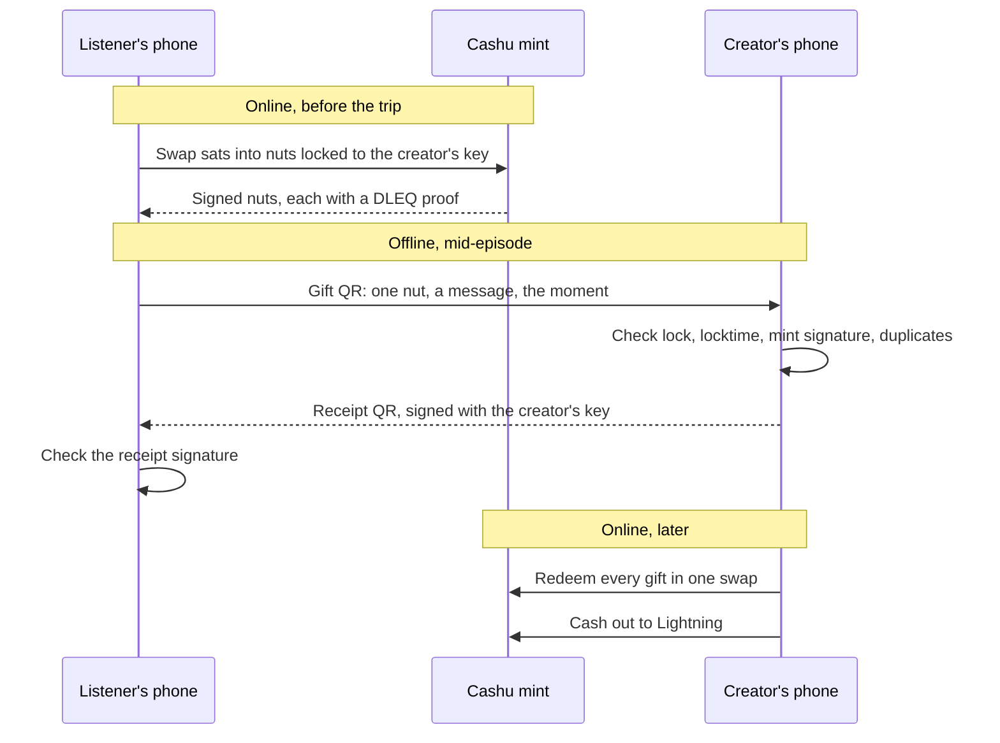
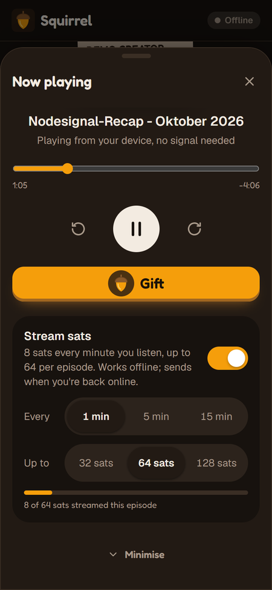
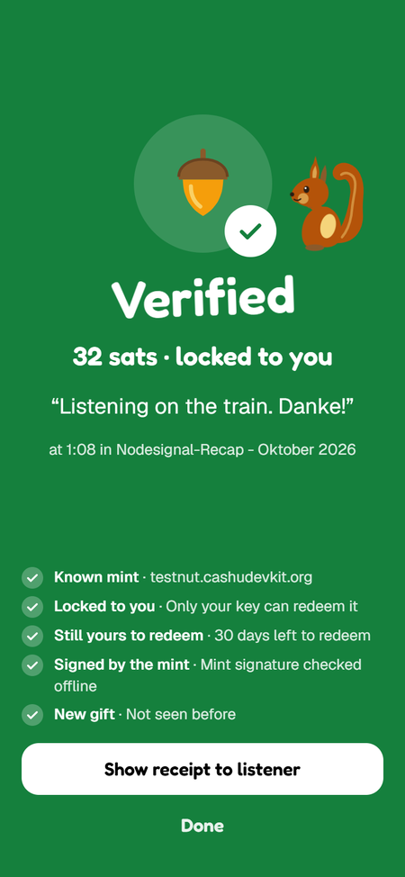
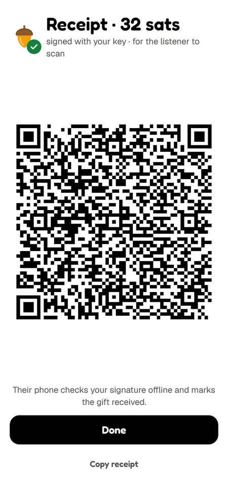
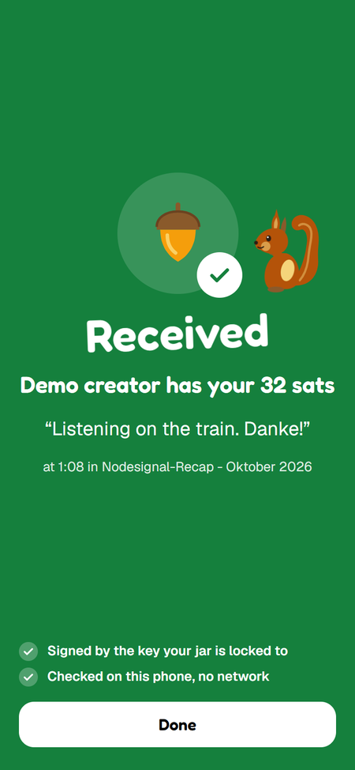
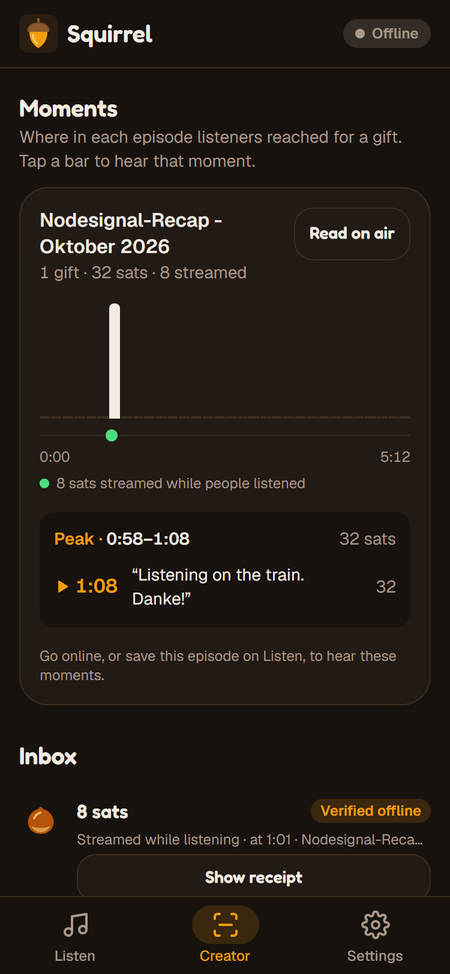
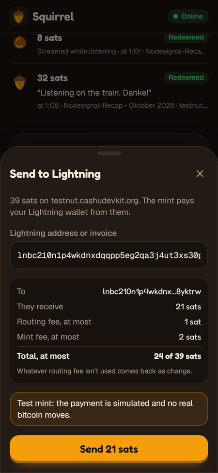

<p align="center"></p>

<h1 align="center">Squirrel</h1>

<p align="center"><b>Stash nuts now, gift them anywhere.</b><br>
Value4Value gifts for podcast listeners that work with no signal on either phone.</p>

<p align="center">Nut November 2026 · Value4Value track · Demo show: <a href="https://nodesignal.space">Nodesignal</a></p>

<p align="center"></p>

<p align="center"><sub>Recorded from the production build by <code>scripts/record-demo.mjs</code>: two phones as two separate browser profiles, both with the network off. Headless Chrome has no camera, so each QR's text goes through the app's Paste box, which runs the same checks as a scan. Test sats only.</sub></p>

## Highlights

- **Gift with no signal.** Sats are locked to the creator's key before the listener goes offline, so a gift handed over as a QR code can't be spent twice.
- **Verify with no signal.** The creator's phone checks the lock, the locktime and the mint's signature (DLEQ) against mint keys it cached earlier.
- **Stream sats offline.** Streaming sats per minute is how Value4Value usually works, and it normally needs a connection. Squirrel does it in airplane mode, capped per episode.
- **Receipts both ways.** The creator's phone signs for each gift and the listener's phone checks the signature, both offline.
- **Out to Lightning.** Creators cash out to any Lightning address or invoice, with every fee shown before paying.
- **Nothing for the show to install.** Nodesignal's RSS feed and its NIP-61 nutzap info are all Squirrel needs.

## The problem

Value4Value assumes you're online at the moment you want to give. Many listeners aren't: they download episodes to save data and listen on the train, on a plane, or wherever signal is bad. By the time they're back online, the moment that made them want to tip has passed.

Lightning can't help here, because a Lightning payment needs both sides online. Cashu tokens are bearer data that can move by QR code with no network at all. The catch is that bearer data handed over offline could be spent twice. Squirrel removes that risk before the listener goes offline.

## How it works



1. **Stash (online).** The listener downloads an episode and funds a small wallet from a Cashu mint. They fill a **jar**: their sats are swapped into fixed-size nuts (8, 32 and 64 sats), each a single Cashu proof **locked to the creator's public key** with a 30-day locktime and the listener's refund key.
2. **Gift (offline).** Mid-episode, the listener taps **Gift**, picks a size and adds a message. One nut from the jar becomes a `cashuB` token carrying the message and the episode timestamp. It's marked spent in the jar so it can't be gifted twice.
3. **Deliver.** In person, the listener shows a QR code. Remotely, the gift is queued and goes out as a [NIP-61](https://github.com/nostr-protocol/nips/blob/master/61.md) nutzap once the listener is back online. The creator's Squirrel collects nutzaps and runs the same checks as a scanned gift before they reach the inbox.
4. **Verify (offline).** The creator scans the QR. With no network, their phone checks that the nut is locked to their key, that the locktime hasn't passed and that the mint really signed it. Then it shows **Verified · 32 sats · locked to you**, and can show the listener a signed receipt.
5. **Redeem (online).** Later, the creator taps **Redeem all**: the nuts are signed with the creator's key and swapped at the mint for ordinary, unlocked ecash, in one swap per mint. From there, **Send to Lightning** pays out to their own wallet.
6. **Refund.** Nuts the creator never redeems come back to the listener after the locktime, through the refund key.

## Screens

<table>
  <tr>
    <td align="center" width="33%"></td>
    <td align="center" width="33%"></td>
    <td align="center" width="33%"></td>
  </tr>
  <tr>
    <td align="center"><b>Stream sats</b><br><sub>Off by default. Rate and cap in plain view.</sub></td>
    <td align="center"><b>Verified offline</b><br><sub>Every check the phone ran, listed.</sub></td>
    <td align="center"><b>Receipt</b><br><sub>Signed with the creator's lock key.</sub></td>
  </tr>
  <tr>
    <td align="center"></td>
    <td align="center"></td>
    <td align="center"></td>
  </tr>
  <tr>
    <td align="center"><b>Received</b><br><sub>The listener's phone checks the signature.</sub></td>
    <td align="center"><b>Moments</b><br><sub>Where listeners gifted, and how far they listened.</sub></td>
    <td align="center"><b>Cash out</b><br><sub>Fees shown before anything is paid.</sub></td>
  </tr>
</table>

## Beyond the core loop

**Streaming sats, offline.** Turn on **Stream sats** in Now Playing. Every 1, 5 or 15 minutes of the episode you play, one 8-sat nut becomes a queued gift stamped with that moment, up to a cap you pick per episode (32, 64 or 128 sats). The cap is counted from the gifts themselves, so reloading the app doesn't reset it. Streamed nuts go out as nutzaps once you're online. On the creator's side, Moments draws them as a lane of dots under the gift bars: the gift bars show where people reached for a gift, and the dots show how far they listened.

**Signed receipts.** After **Verified**, the creator taps **Show receipt to listener**. Their phone signs the nut's id with the creator's lock key (a BIP-340 Schnorr signature) and shows it as a QR of about 200 characters, much sparser than the gift's. The listener taps **Scan their receipt**. Their phone checks the signature against the key the jar was locked to, the only key that can redeem the nut, and marks the gift **Receipt signed**. Neither phone needs a network.

**Cash out to Lightning.** Under **Your redeemed sats**, **Send to Lightning** takes a Lightning address (LUD-16) or a BOLT11 invoice and pays it from the creator's redeemed ecash with a NUT-05 melt. It gets a quote first and shows what the recipient gets, the most the routing and mint fees can be, and the total. Sats already moved to another wallet are found with NUT-07 and dropped from the balance, so the number on screen stays true.

## Why an offline gift is safe

| Risk | What stops it |
| --- | --- |
| The listener spends the nut again after handing it over | It's P2PK-locked to the creator ([NUT-11](https://github.com/cashubtc/nuts/blob/main/11.md)). Only a signature from the creator's key can spend it before the locktime. The mint rejects the listener's own key (tested: `20008 P2PK spend conditions are not met`). |
| A forged token | The creator checks the mint's DLEQ proof ([NUT-12](https://github.com/cashubtc/nuts/blob/main/12.md)) offline against mint keys cached on their phone. A changed signature fails. |
| A real token from a mint the creator doesn't trust | Gifts only verify on mints whose keys the creator's phone already holds. |
| A nut someone else could also spend | The creator's phone requires the set of keys that can sign right now to be exactly the creator's key. |
| The same nut shown twice | The inbox keys gifts by the nut's secret. A repeat shows "Already received" and is counted once. |
| The creator never redeems | After 30 days, the listener's refund key can reclaim the nut. The creator sees the deadline on every gift. |
| A fake receipt | A receipt only verifies with a signature from the jar's lock key, the creator's key. Anyone else's signature, or one for a different nut, is rejected. |

The listener still trusts the mint, as with all Cashu use.

## Nodesignal integration

Squirrel works with Nodesignal through open standards, so Nodesignal doesn't need to install anything.

- **Content:** the app reads Nodesignal's public RSS feed (server-side, via `/api/feed`) and downloads episodes for offline playback.
- **Recipient key:** Settings → **Nodesignal** reads their NIP-61 nutzap info (kind 10019) from Nostr: the P2PK key to lock to, their trusted mints and their relays.
- **Delivery:** queued gifts and streamed nuts are published as kind 9321 nutzaps tagged to Nodesignal's npub, on their relays.
- **Context:** like the boosts hosts read on air, each gift carries the message and the moment in the episode that prompted it. **Read on air** lists them in episode order, ready for show notes.

Before publishing, Squirrel re-reads the creator's kind 10019 and refuses to send unless the gift's mint is one they list and the nut is locked to their listed key, as NIP-61 requires. A nutzap on a mint the creator doesn't use could never be claimed.

**How any creator can claim gifts:** publish a kind 10019 event with a `pubkey` tag (a P2PK key that is not your main Nostr key), `mint` tags for the mints you accept, and `relay` tags. Any NIP-61 wallet can then redeem nutzaps sent to you. Nodesignal already has one.

Nodesignal funded the Cashu DLEQ bounty, whose stated goal includes safe offline token transfers. Squirrel's offline check is that work in use.

## Standards used

| Area | Spec | Used for |
| --- | --- | --- |
| Cashu | NUT-00 | `cashuB` gift tokens |
| | NUT-05 | Melting redeemed sats to pay Lightning |
| | NUT-07 | Proof state: refunds, "redeemed" status, cash-out balance |
| | NUT-10, NUT-11 | P2PK locks with a locktime and a refund key |
| | NUT-12 | DLEQ proofs, checked offline |
| Nostr | NIP-19 | npubs |
| | NIP-61 | Kind 10019 nutzap info, kind 9321 nutzaps |
| | NIP-65 | Relays |
| | NIP-73 | Podcast episode ids on nutzaps |
| Lightning | BOLT11, LUD-16 | Invoices and Lightning addresses for cash-out |
| Bitcoin | BIP-340 | Schnorr signatures on receipts |

## Try it

```bash
npm install
cp .env.example .env.local   # optional: the defaults work
npm run build && npm start   # service workers only run in production builds
```

Open http://localhost:3000. The camera needs HTTPS, so on a phone use the deployed build, or **Paste a gift** on the Creator tab.

**The whole loop on one device:** open **Creator** and generate a key, set **Settings → Demo creator**, add test sats and fill a jar on **Listen**, gift from the player, then paste or scan the gift on **Creator**. For the remote path with test sats, tap **Publish nutzap info** on Creator before choosing Demo creator; gifts sent with **Send later** then show up on Creator as verified nutzaps.

**Checks against the test mint** (they never publish anything):

```bash
stage0/node_modules/.bin/tsx scripts/check-receive.mts
```

```bash
stage0/node_modules/.bin/tsx scripts/check-receipt-cashout.mts
```

The first runs the nutzap path end to end; the second covers streamed nuts, receipts and a Lightning cash-out.

**Re-recording the demo:** with a production build running, `BASE=http://localhost:3000 node scripts/record-demo.mjs` regenerates `docs/demo.gif` and `docs/screens/`. It needs Chrome and ffmpeg.

**About the test mints:** the default mint is `testnut.cashudevkit.org`, whose invoices pay themselves. That also means it pays its own invoices within seconds and then refuses to melt to them ("Invoice already paid"), so to try a cash-out, pay an invoice from a different mint or wallet, such as `testnut.cashu.space`.

## Architecture

One Next.js app, installed as a PWA, with all user data on the device and no backend database.

| Part | Choice |
| --- | --- |
| App | Next.js 16 (App Router), TypeScript, Tailwind CSS 4 |
| Offline | Service worker caching the app shell only; versioned per build |
| Storage | IndexedDB (`idb`): wallet, jars, gifts, inbox, mint keys, episode audio |
| Ecash | `@cashu/cashu-ts` 4.12 |
| Nostr | `nostr-tools` |
| QR | `qrcode.react`; camera scanning with `BarcodeDetector`, `jsQR` fallback |
| Feed | Route handler `/api/feed`, cached for an hour |

| File | What it does |
| --- | --- |
| `lib/wallet.ts` | Fund the wallet, fill jars with locked nuts |
| `lib/gift.ts` | Turn a nut into a gift, offline |
| `lib/verify.ts` | The creator's offline checks |
| `lib/receipt.ts` | Sign and check receipts |
| `lib/stream.ts` | Streaming sats while listening |
| `lib/nutzap.ts` | Send queued gifts as nutzaps |
| `lib/receive.ts` | Publish kind 10019, collect nutzaps |
| `lib/creator.ts` | Redeem gifts |
| `lib/cashout.ts` | Cash out to Lightning |
| `lib/refund.ts` | Reclaim nuts after the locktime |
| `lib/moments.ts` | Where in each episode gifts landed |

`stage0/` holds the standalone scripts that proved each risky piece before any UI existed.

## Limitations

- A jar has to be filled for a specific creator in advance, while online.
- The creator must redeem within the locktime (30 days), or the listener can take the nut back.
- The listener trusts the mint, as with any Cashu use. The creator only accepts mints whose keys their phone has cached.
- Keys live in browser storage with no backup. This is a demo: fine for test sats and small amounts, not for savings.
- Each redeem pays the mint's input fee (1 sat per 10 nuts on the test mint), so a single 32-sat gift redeems to 31.
- Camera scanning needs HTTPS. Very dense QR codes (long messages) scan slower on older phones.

## Next steps

- NFC or Bluetooth handover as an alternative to QR
- Key backup (NUT-13 seed) and multiple creators per listener
- A podcast app integration: gift straight from the player in apps that already support V4V
- Deterministic nut secrets so a lost phone can restore its jar from the mint
