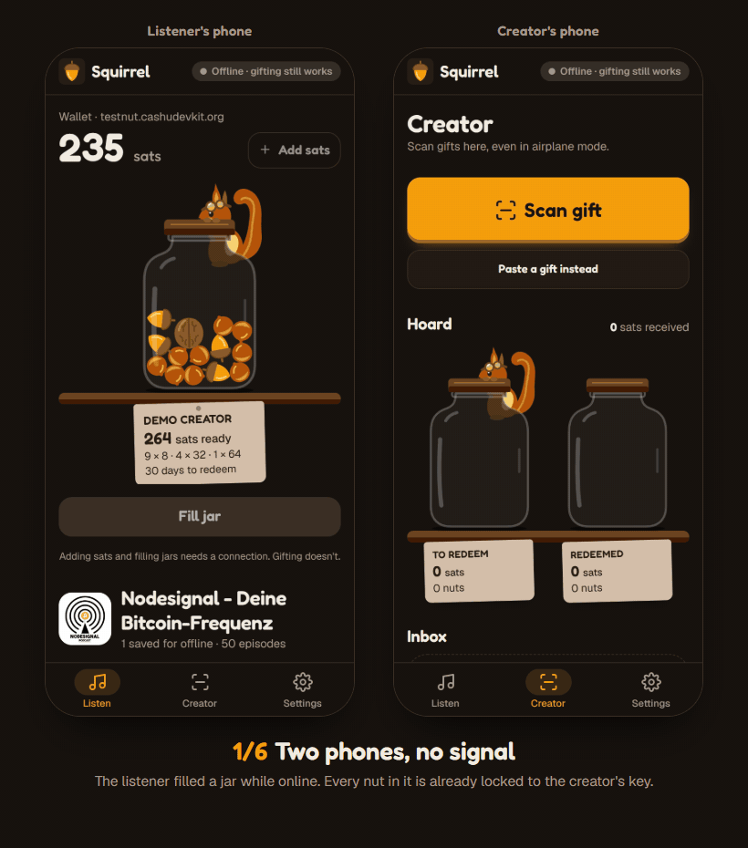

# Squirrel

**Stash nuts now, gift them anywhere.** Squirrel lets podcast listeners gift creators in Cashu ecash with no internet connection, using tokens locked to the creator in advance so they're safe to accept offline.

A Nut November 2026 submission for the Value4Value track. Demo show: [Nodesignal](https://nodesignal.space).



## The problem

Value4Value assumes you're online at the moment you want to give. Many listeners aren't: they download episodes to save data and listen on the train, on a plane, or wherever signal is bad. By the time they're back online, the moment that made them want to tip has passed.

Lightning can't help here, because a Lightning payment needs both sides online. Cashu tokens are bearer data that can move by QR code with no network at all. The catch is that bearer data handed over offline could be spent twice. Squirrel removes that risk before the listener goes offline.

## How it works

1. **Stash (online).** The listener downloads an episode and funds a small wallet from a Cashu mint. They fill a **jar**: their sats are swapped into fixed-size nuts (8, 32 and 64 sats), each a single Cashu proof **locked to the creator's public key** with a 30-day locktime and the listener's refund key.
2. **Gift (offline).** Mid-episode, the listener taps **Gift**, picks a size and adds a message. One nut from the jar becomes a `cashuB` token carrying the message and the episode timestamp. It's marked spent in the jar so it can't be gifted twice.
3. **Deliver.** In person, the listener shows a QR code. Remote, the gift is queued and goes out as a [NIP-61](https://github.com/nostr-protocol/nips/blob/master/61.md) nutzap once the listener is back online.
4. **Verify (offline).** The creator scans the QR. With no network, their phone checks that the nut is locked to their key, that the locktime hasn't passed, and that the mint really signed it. Then it shows **Verified · 32 sats · locked to you**.
5. **Redeem (online).** Later, the creator taps **Redeem all**: each nut is signed with the creator's key and swapped at the mint for ordinary, unlocked ecash.
6. **Refund.** Nuts the creator never redeems come back to the listener after the locktime, through the refund key.

## Why an offline gift is safe

| Risk | What stops it |
| --- | --- |
| The listener spends the nut again after handing it over | It's P2PK-locked to the creator ([NUT-11](https://github.com/cashubtc/nuts/blob/main/11.md)). Only a signature from the creator's key can spend it before the locktime. The mint rejects the listener's own key (tested: `20008 P2PK spend conditions are not met`). |
| A forged token | The creator checks the mint's DLEQ proof ([NUT-12](https://github.com/cashubtc/nuts/blob/main/12.md)) offline against mint keys cached on their phone. A changed signature fails. |
| A real token from a mint the creator doesn't trust | Gifts only verify on mints whose keys the creator's phone already holds. |
| A nut someone else could also spend | The creator's phone requires the set of keys that can sign right now to be exactly the creator's key. |
| The same nut shown twice | The inbox keys gifts by the nut's secret. A repeat shows "Already received" and is counted once. |
| The creator never redeems | After 30 days, the listener's refund key can reclaim the nut. The creator sees the deadline on every gift. |

The listener still trusts the mint, as with all Cashu use.

## Nodesignal integration

Squirrel works with Nodesignal through open standards, so Nodesignal doesn't need to install anything.

- **Content:** the app reads Nodesignal's public RSS feed (server-side, via `/api/feed`) and downloads episodes for offline playback.
- **Recipient key:** Settings → **Nodesignal** reads their NIP-61 nutzap info (kind 10019) from Nostr: the P2PK key to lock to, their trusted mints and their relays.
- **Delivery:** queued gifts are published as kind 9321 nutzaps tagged to Nodesignal's npub, on their relays.
- **Context:** like the V4V boosts hosts read on air, each gift carries the message and the moment in the episode that prompted it.

Before publishing, Squirrel re-reads the creator's kind 10019 and refuses to send unless the gift's mint is one they list and the nut is locked to their listed key, as NIP-61 requires. A nutzap on a mint the creator doesn't use could never be claimed.

**How any creator can claim gifts:** publish a kind 10019 event with a `pubkey` tag (a P2PK key that is not your main Nostr key), `mint` tags for the mints you accept, and `relay` tags. Any NIP-61 wallet can then redeem nutzaps sent to you. Nodesignal already has one.

Nodesignal funded the Cashu DLEQ bounty, whose stated goal includes safe offline token transfers. Squirrel's offline check is that work in use.

## Standards used

- Cashu: NUT-00 (cashuB tokens), NUT-07 (proof state, for refunds), NUT-10/11 (P2PK with locktime and refund keys), NUT-12 (offline DLEQ)
- Nostr: NIP-19 (npub), NIP-61 (kind 10019 nutzap info, kind 9321 nutzaps), NIP-65 relays

## Architecture

One Next.js app, installed as a PWA, with all user data on the device and no backend database.

| Part | Choice |
| --- | --- |
| App | Next.js 16 (App Router), TypeScript, Tailwind CSS 4 |
| Offline | Service worker caching the app shell only; versioned per build |
| Storage | IndexedDB (`idb`): wallet, jars, gifts, inbox, mint keys, episode audio |
| Ecash | `@cashu/cashu-ts` 4.12 |
| Nostr | `nostr-tools` |
| QR | `qrcode.react`; camera scanning with `BarcodeDetector`, `jsQR` fallback |
| Feed | Route handler `/api/feed`, cached for an hour |

Key files: `lib/wallet.ts` (fund, fill jar), `lib/gift.ts` (offline gift), `lib/verify.ts` (offline checks), `lib/creator.ts` (redeem), `lib/nutzap.ts` (NIP-61), `lib/refund.ts` (reclaim). `stage0/` holds the standalone scripts that proved each risky piece before any UI existed.

## Run it locally

```bash
npm install
cp .env.example .env.local   # optional: the defaults work
npm run build && npm start   # service workers only run in production builds
```

Open http://localhost:3000. The camera needs HTTPS, so on a phone use the deployed build (or **Paste a gift** on the Creator tab).

To try the whole loop on one device: open **Creator** and generate a key, set **Settings → Demo creator**, add test sats and fill a jar on **Listen**, gift from the player, then paste or scan the gift on **Creator**.

The default mint is `testnut.cashudevkit.org`, a test mint whose invoices pay themselves. `testnut.cashu.space` is the usual choice but returned HTTP 503 during development.

## Limitations

- A jar has to be filled for a specific creator in advance, while online.
- The creator must redeem within the locktime (30 days), or the listener can take the nut back.
- The listener trusts the mint, as with any Cashu use. The creator only accepts mints whose keys their phone has cached.
- Keys live in browser storage with no backup. This is a demo: fine for test sats and small amounts, not for savings.
- Each redeem pays the mint's input fee (1 sat on the test mint), so a 32-sat gift redeems to 31.
- Camera scanning needs HTTPS. Very dense QR codes (long messages) scan slower on older phones.

## Next steps

- NFC or Bluetooth handover as an alternative to QR
- Key backup (NUT-13 seed) and multiple creators per listener
- A podcast app integration: gift straight from the player in apps that already support V4V
- Deterministic nut secrets so a lost phone can restore its jar from the mint
